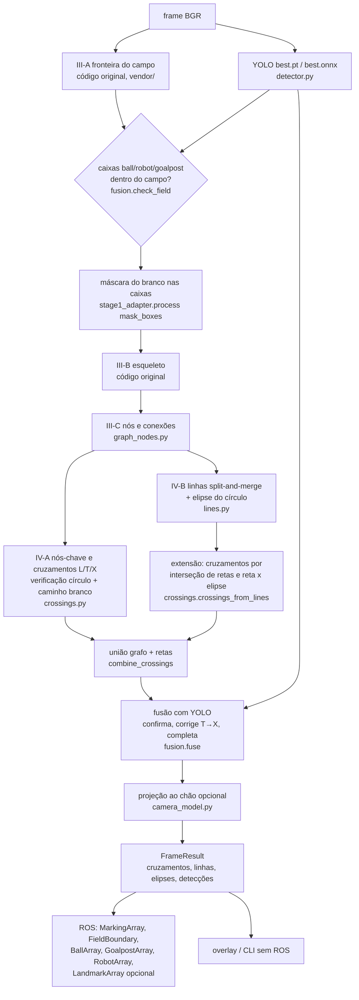

# Arquitetura do `robocup_line_vision`

Implementação do artigo *"Line Structure-based Localization for Soccer Robots"*
(Schulz, Liu, Stückler, Behnke, Humanoids 2009), Seções III e IV, integrada ao
detector YOLO da EDROM. O filtro de partículas (Seção V) **não** faz parte do
pacote: a EDROM já tem o `localization_pkg`, e este pacote só o alimenta.

## Fluxo de um frame

Tudo que é limiar está em `config/params.yaml` (lido por `params.py`). O núcleo
não importa nada de ROS; o nó ROS (`ros/line_vision_node.py`) só converte
mensagens.

## Um módulo por seção do artigo

### III-A e III-B — `vendor/` + `stage1_adapter.py` (código original)

* `vendor/main.py` (`Pixel_Segment`) e `vendor/def_white_threshold.py` são
  cópias do repositório original da etapa 1, **sem mudança de lógica**. A lista
  exata das linhas alteradas (só importação e caminho) está em
  `vendor/VENDOR.md`.
* Grade de 1/8 da imagem (1080x720 → 135x90; 640x480 → 80x60), imagem cinza
  `branco·0,5 + verde`, binarização por `tpix`, `trow`, `twin`, histograma de
  altura por coluna, mediana + gaussiana, filtro de convexidade local, máscara
  do campo; branco dentro do campo → borrão gaussiano 5x5 → operador de ranking
  `c(x,y) < 3` → esqueleto.
* `stage1_adapter.Stage1Segmenter` resolve três problemas do código original
  sem mexer nele: (1) lê o limiar do branco do CSV desejado executando o
  próprio `def_white_threshold.py` num módulo isolado; (2) uma instância por
  calibração (cópia isolada do `main.py`); (3) mascara o branco nas caixas do
  YOLO **entre** a fronteira e o esqueleto. Sem caixas, o resultado é
  idêntico ao `processar()` original (teste `test_equivalente_ao_processar`;
  conferido também contra o repositório original nos 6 frames).
* `ranking_count` recalcula `c(x,y)` (a III-C precisa separar picos de cumes;
  a etapa 1 não devolve esse mapa).

### III-C — `graph_nodes.py` (nós e conexões)

1. **Nós**: primeiro nos picos (`c = 0`), depois nos cumes (`c = 1, 2`), a pelo
   menos 2 pixels (Chebyshev) de qualquer nó. Ordem total e explícita
   (`np.lexsort`: picos, cinza decrescente, `c`, `y`, `x`), para não depender
   do desempate do `argsort` (o problema medido antes entre versões do numpy).
2. **Conexões locais**: liga nós cujas regiões 3x3 se sobrepõem ou se tocam
   *no esqueleto* (existe caminho-8 de esqueleto dentro da união das regiões).
   Triângulos (esqueleto grosso) perdem a aresta mais longa.
3. **Informação global**:
   * pontas são **esticadas** até o último pixel do esqueleto;
   * nós de **grau 0** são **divididos** em dois para preencher lacunas (exceto
     picos isolados, que costumam ser o centro de uma junção);
   * **conexões candidatas** ponta→nó, avaliadas por continuidade (desvio de
     direção), fechamento (cinza ao longo do segmento / cinza dos nós) e
     simplicidade (distância);
   * conexões candidatas **ponta→aresta** (forma T/X quando a haste termina em
     cima de uma aresta que já atravessa a junção — caso medido no sintético);
   * restrições: grau máximo 4, junções de grau 3/4 só se resultarem em linhas
     contínuas (pares de arestas colineares), nenhuma aresta cruzando outra.

### IV-A — `crossings.py` (cruzamentos L/T/X)

1. Suavização dos nós de grau 2 (média com os vizinhos, recolocada **sobre o
   esqueleto**).
2. Eliminação de linhas curtas que terminam em junções.
3. Remoção dos nós de baixa curvatura → estrutura de nós-chave (Fig. 2d).
4. Fusão de junções próximas e conectadas (o nó novo fica no pixel de esqueleto
   mais claro / na interseção das arestas externas, no caso de cantos).
5. Tipo pelo grau: 2 com ângulo característico = **L**, 3 = **T**, 4 = **X**.
   Checagens geométricas: T exige um par de braços colineares, X dois pares
   (retas continuam retas na perspectiva); L exige curvatura concentrada no
   vértice e não pode estar numa sequência de cantos girando para o mesmo lado
   (assinatura do círculo); L e T sobre a elipse do círculo central são
   descartados.
6. **Verificação** (artigo): máquina de estados verde→branco→verde num círculo
   centrado no cruzamento (raios 2, 3 e 4 células) e caminho branco do
   cruzamento até os vizinhos em cada direção, nas imagens subamostradas. O
   limiar do branco é relativo ao nível de branco das próprias linhas.
7. `heading_rays` em [0, 2π), ordem crescente, convenção de
   `MarkingIntersection` (0 = +x da imagem, π/2 = +y).

**Extensão (fora do artigo, ligada por padrão, `saida.cruzamentos_de_retas`)**:
`crossings_from_lines` gera candidatos pela interseção das retas da IV-B
(ponta+ponta = L, ponta+meio = T, meio+meio = X) e pela interseção de reta com a
elipse do círculo central (X da linha do meio). Os candidatos passam pela
**mesma verificação** da IV-A. `combine_crossings` dá prioridade ao grafo.
Motivo medido em `docs/decisoes.md` (D10).

### IV-B — `lines.py` (linhas e círculo)

* Componentes conexos de nós de grau 2 + nós de outro grau ligados a eles,
  ordenados ao longo da cadeia.
* Coordenadas **corrigidas da distorção** (`camera_model.undistort_points`)
  quando há modelo de câmera com distorção (câmera real da EDROM).
* **Split**: reta por mínimos quadrados totais; divide no nó mais distante se
  a distância passar de `split_dist`; recursivo; descarta componentes com
  menos de 3 nós. **Merge**: une segmentos com ângulo e deslocamento parecidos
  se a união continuar sendo uma reta.
* Extremos = projeção dos extremos do componente na reta ajustada.
* Projeção ao chão (opcional): (distância perpendicular, ângulo do pé da
  perpendicular, comprimento) no referencial egocêntrico.
* **Círculo central**: no esqueleto ele vira cadeias de grau 2 que o split
  cortaria em pedaços curtos. Cadeias curvas que juntas cabem numa elipse
  (`cv2.fitEllipse`, rms ≤ 0,6 célula, cobertura ≥ 120°) viram
  `EllipseFeature` (publicadas em `MarkingArray.ellipses`) e saem da lista de
  linhas.

### Fusão com o YOLO — `fusion.py` e `detector.py`

* `detector.py`: interface `Detector`; `UltralyticsDetector` (`best.pt`, com
  `imgsz=320, conf=0.45, iou=0.5, max_det=10`, como o nó `finder`),
  `OnnxDetector` (só `onnxruntime` + numpy, sem torch) e `NullDetector`.
* Classes sempre **pelo nome** (`'L-Intersection'`, ...), nunca pelo número.
* Caixas `ball`, `robot`, `goalpost` mascaram o branco antes do esqueleto.
* Detecção fora do campo segmentado → rejeitada (`outside_field`); objetos de
  pé são testados pela base da caixa.
* Cruzamento do grafo confirmado por caixa do mesmo tipo → confiança sobe.
  T do grafo + X do YOLO no mesmo lugar → vira X (o 4º raio é o oposto da
  haste). Cruzamento só do YOLO → entra rebaixado (×0,5), sem `heading_rays`.

### Saídas

* `features.py`: `CrossingFeature(tipo, x, y, heading_rays, confianca, fonte,
  verificacao, distancia_m, angulo_rad)`, `LineFeature(x1, y1, x2, y2,
  confianca, n_nos, rms_px, distancia_m, angulo_rad, comprimento_m)`,
  `EllipseFeature`, `Detection`.
* ROS (`ros/msg_conversion.py`): `MarkingArray` (`intersections` com
  `heading_rays`, `segments`, `ellipses`), `FieldBoundary`, `BallArray`,
  `GoalpostArray`, `RobotArray`, `sensor_msgs/Image` (overlay) e, opcional,
  `edrom_msgs/LandmarkArray`.

## Ferramentas

| Arquivo | Para quê |
|---|---|
| `calibration/calibrator_cv.py` | calibrador ao vivo (HighGUI) — P0 |
| `calibration/calibrador.html` | calibrador offline num arquivo só (navegador) — P0 |
| `calibration/capture_frames.py` / `capture_frames_ros.py` | captura de frames (câmera / tópico) |
| `calibration/importar_json.py` | JSON do HTML → pasta de calibração versionada |
| `__main__.py` | modo sem ROS (`python3 -m robocup_line_vision`) |
| `synthetic.py` | campo KidSize sintético com verdade de terreno |
| `evaluation.py`, `tools/avaliar_gt.py`, `tools/avaliar_sintetico.py` | métricas |
| `tools/validar_calibracao.py` | validação do P0 |
| `tools/medir_fps.py` | tempo por frame |
